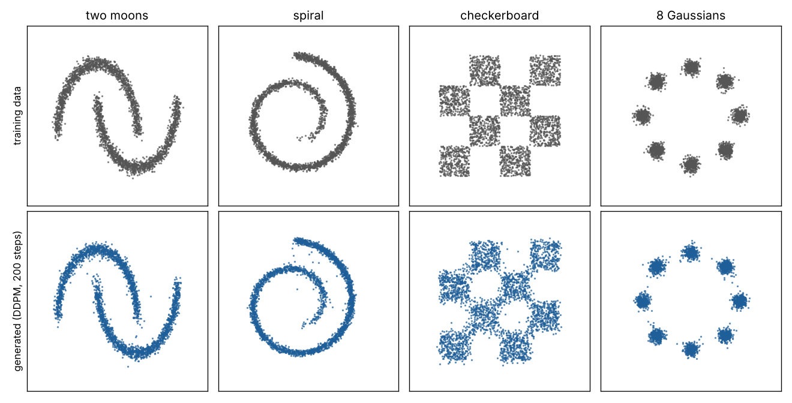
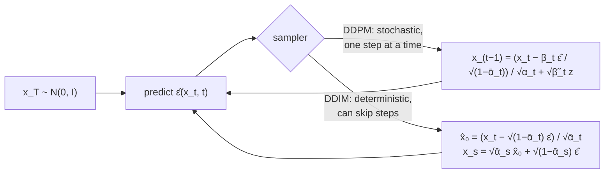
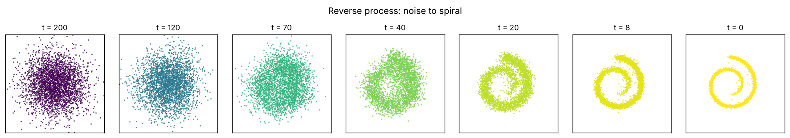
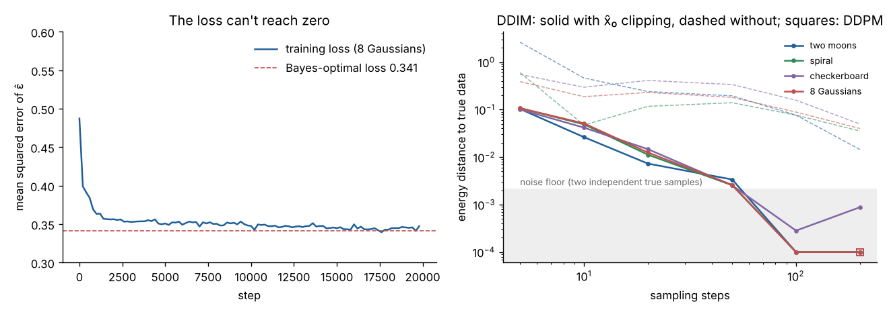
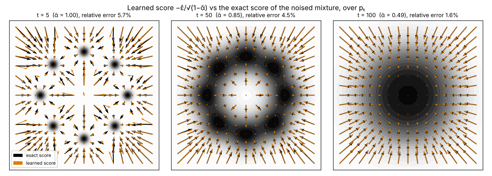

# toy-diffusion

Denoising diffusion models (DDPM and DDIM) on 2-D data, in NumPy, with the network's backward
pass written by hand. One of the datasets, a Gaussian mixture, has a score that can be computed
exactly. That makes it possible to check the samplers independently of training, and to measure
how far the learned score is from the true one.



Each model is a 37,762-parameter MLP trained for 20,000 steps (about 100 s each on a 2-vCPU cloud
VM). Every sample set above is statistically indistinguishable from the data by the energy
distance (table below).

## How it works

The forward process adds Gaussian noise over T = 200 steps with a cosine schedule (Nichol &
Dhariwal, 2021). In closed form,

$$x_t = \sqrt{\bar\alpha_t}\,x_0 + \sqrt{1-\bar\alpha_t}\,\varepsilon,\qquad \varepsilon \sim \mathcal N(0, I).$$

A network ε̂(xₜ, t) is trained to predict ε by minimising ‖ε̂ − ε‖². Its optimum is
ε̂* = −√(1−ᾱₜ) ∇log pₜ(x), so **a noise predictor is a score model**. Sampling runs the process
backwards:





## Checking against the exact score

For a mixture Σₖ wₖ N(μₖ, s²I), every noised marginal is again a mixture,
pₜ = Σₖ wₖ N(√ᾱₜ μₖ, (ᾱₜs² + 1 − ᾱₜ) I). Its score is therefore known in closed form, as a
responsibility-weighted sum of Gaussian scores. A test checks that formula against finite
differences of log pₜ. That gives three independent checks:

1. **The samplers.** With the exact ε* plugged in, both DDPM and DDIM must reproduce the mixture.
   They do, to within the noise floor of the metric, and with the right weight on each of the eight
   modes. This tests the sampling code with no training involved.
2. **The loss floor.** The training loss can't reach zero. Even the exact ε* leaves an error,
   because xₜ doesn't determine ε. A Monte Carlo estimate of that Bayes-optimal loss is about 0.34,
   and the trained network's final loss is 0.345:

   

3. **The learned score itself.** The relative error ‖ε̂ − ε*‖ / ‖ε*‖ is measured on points drawn
   from pₜ:

   | t | 5 | 20 | 50 | 100 | 150 |
   |---|---:|---:|---:|---:|---:|
   | relative error | 5.7 % | 8.0 % | 4.5 % | 1.6 % | 1.1 % |

   

   The error is largest at small t, where pₜ has sharp peaks and almost no mass in between. The
   network rarely sees those in-between points, so its arrows there are less accurate.

## Sample quality

The metric is the energy distance D² = 2E‖X−Y‖ − E‖X−X′‖ − E‖Y−Y′‖ (Székely & Rizzo). It is zero
exactly when the two distributions are equal, and needs no bandwidth or binning. It is computed on
3,000 generated points against 3,000 fresh data points. The "noise floor" compares two independent
draws from the true distribution. The unbiased estimator can be slightly negative.

| dataset | noise floor | DDPM, 200 steps | DDIM, 50 steps | DDIM, 20 steps | DDIM, 10 steps |
|---|---:|---:|---:|---:|---:|
| two moons | −0.0007 | −0.0003 | 0.0034 | 0.0073 | 0.026 |
| spiral | −0.0004 | −0.0004 | 0.0026 | 0.011 | 0.049 |
| checkerboard | 0.0029 | −0.0002 | 0.0025 | 0.015 | 0.042 |
| 8 Gaussians | −0.0002 | −0.0008 | 0.0026 | 0.013 | 0.051 |

DDPM with all 200 steps is at the noise floor on every dataset. DDIM reaches the floor at 100
steps and degrades gradually below that.

**One detail made the difference for DDIM.** The cosine schedule ends at ᾱ_T ≈ 6 × 10⁻⁸, so DDIM's
first step divides by √ᾱ_T ≈ 2.5 × 10⁻⁴. Any error in ε̂ there is amplified thousands of times.
With the exact score this is harmless: unclipped DDIM is at the floor from 20 steps. With the
learned network, unclipped DDIM never gets there (dashed lines in the plot: 0.014–0.050 even at
200 steps). Clipping x̂₀ to the data range [−3, 3] and re-deriving ε̂ from it, as most
implementations do, fixes this (solid lines). DDPM doesn't need the fix, because the fresh noise it
adds at every step swamps the error.

## Tests

18 tests, about 3 s:
- the closed-form marginal against simulating the chain step by step;
- the posterior q(xₜ₋₁ | xₜ, x₀) against Bayes' rule;
- both schedules ending in noise;
- network gradients by finite differences;
- the exact mixture score against ∇log pₜ;
- both samplers recovering the mixture from the exact score;
- energy distance detecting a shift;
- dataset scaling;
- training approaching the Bayes-optimal loss;
- a gradient step lowering the loss.

## Run it

```bash
pip install -r requirements.txt pytest
pytest -q
python scripts/run_experiments.py           # trains four models, about 8 minutes
pip install matplotlib && python scripts/figures.py
```

## Details and limits

- Network: [x, 32 sinusoidal time features] → 3 × 128 SiLU → 2. Adam (lr 2 × 10⁻³, cosine decay),
  batch 512 of fresh samples every step, and an exponential moving average of the weights
  (decay 0.999), which is what gets sampled from.
- Toy scale on purpose: in 2-D you can see every sample and compute the exact answer, which is
  hard to do for images.
- One training seed per dataset. The energy-distance numbers move by about ±0.001 between
  evaluation seeds.

## References

- J. Ho, A. Jain, P. Abbeel, *Denoising Diffusion Probabilistic Models*, NeurIPS (2020).
- J. Song, C. Meng, S. Ermon, *Denoising Diffusion Implicit Models*, ICLR (2021).
- A. Nichol, P. Dhariwal, *Improved Denoising Diffusion Probabilistic Models*, ICML (2021).
- P. Vincent, *A Connection Between Score Matching and Denoising Autoencoders*, Neural Computation 23 (2011).
- Y. Song, S. Ermon, *Generative Modeling by Estimating Gradients of the Data Distribution*, NeurIPS (2019).
- G. J. Székely, M. L. Rizzo, *Energy statistics: A class of statistics based on distances*, J. Stat. Plan. Inference 143 (2013).

## License

Copyright (c) 2026 Ankit Pawar. All Rights Reserved.

This repository is public so that the work can be read and evaluated, but it is not open source. Using, copying, modifying, redistributing or commercially exploiting any part of it requires prior written permission. This does not affect what applicable law allows without permission, or viewing and forking the repository on GitHub under GitHub's Terms of Service. The full terms are in [LICENSE](LICENSE).

Commits up to and including `717fe66` were released under the MIT License, and copies obtained under those terms keep them.

For licensing or collaboration, email ankitpawar0007x@gmail.com or visit [ankitinorbit.com](https://ankitinorbit.com).
